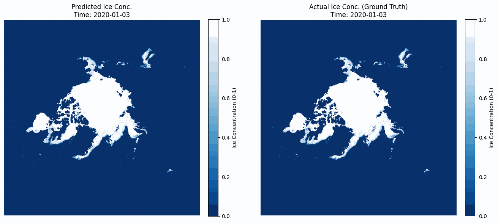

# Forecasting Arctic sea ice with a ConvLSTM

Daily Arctic sea-ice concentration forecasting from twenty years of passive-microwave satellite data. A three-layer ConvLSTM looks at the last three days of ice and predicts the next day over the whole Northern Hemisphere grid.



The animation is a free-running forecast for 2020. The model is given three observed days at the start of January, and from then on it only sees its own predictions, rolling forward one day at a time for the rest of the year. The right panel is what the satellites recorded.

## Data

- **Source:** the EUMETSAT OSI SAF sea-ice concentration climate data record (version 3, OSI-458) from the AMSR sensors, downloaded from the [Copernicus Climate Data Store](https://cds.climate.copernicus.eu/datasets/satellite-sea-ice-concentration).
- **Coverage:** daily fields for the Northern Hemisphere, 2002 to 2021.
- **Grid:** 432 × 432 cells on the 25 km EASE2 polar grid.
- **Preparation:** gaps are filled linearly in time and then by nearest neighbour in space, cells that are still missing are set to zero, and concentrations are scaled to the range 0 to 1. The prepared fields are written to Zarr as train, validation and test splits.

## Notebooks

Run them in order.

| Notebook | What it does |
|---|---|
| `01_cdsapi` | Pulls the data through the CDS API and takes a first look at the NetCDF files |
| `02_cartopy` | Plots the fields on a polar map |
| `03_interpolation` | Works out the gap filling, in time and then in space |
| `04_arima` | Per-pixel ARIMA(1,0,0) baseline, fitted across the whole grid in parallel with xarray and Dask |
| `05_lstm` | Builds and tests the ConvLSTM |
| `06_training` | Trains the model from the Zarr splits on a Kaggle GPU, with TensorBoard logging |
| `07_visualization` | Loads the best checkpoint, runs the 2020 forecast and writes the GIFs |

## Model

The model lives in `src/model.py`. It is a ConvLSTM with peephole connections: three stacked layers with 32, 64 and 128 hidden channels and 3 × 3 kernels, then a 1 × 1 convolution back to a single channel and a sigmoid so the output stays between 0 and 1. It has about 1.2 million parameters.

Training uses three consecutive days as input and the following day as the target. It uses MSE loss, Adam at a learning rate of 1e-3, mixed precision, a batch size of 2 and 20 epochs. Each epoch draws a random 25% of the training sequences to keep epochs short. The best checkpoint, the epoch-19 checkpoint and the TensorBoard log are in `trained_model/`.

## Running it

You need a [CDS account](https://cds.climate.copernicus.eu/) with your API key in `~/.cdsapirc`.

```bash
pip install -r requirements.txt
pip install xarray dask zarr netCDF4 scipy statsmodels cartopy imageio tensorboard
```

`requirements.txt` is a partial freeze of the download environment, which is why the second line is there.

`src/dataloader.py` holds the CDS request and the unzip step. It requests two years at a time to stay under the CDS request limit. The download loop is commented out in the current version, so uncomment it before a fresh pull. `src/train.py` is an early CPU stub; the training that produced the checkpoints is in `06_training`.

## Author

[Navneet Melarkode](https://melarkode.github.io), 2025.
